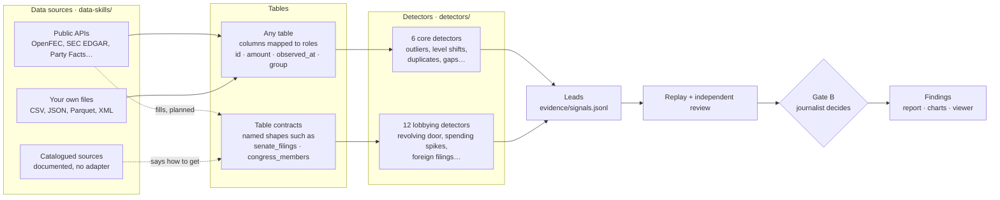

<div align="center">

# Anomaly

### Evidence-led data investigations for AI agents

**Anomaly finds unusual patterns in structured data and turns them into reviewed findings you can replay. It has 34 public-data sources, 18 released detectors and two journalist gates.**

[How it works](#how-it-works) | [Tables](#how-a-detector-gets-its-table) | [Workflow](#workflow) | [Spotlight](#use-from-spotlight) | [Website](https://anomaly.buriedsignals.com/)

[](#data-sources)[](#detectors)[](#workflow)

Built by [**Buried Signals**](https://buriedsignals.com/) • [tom@buriedsignals.com](mailto:tom@buriedsignals.com)

</div>

---

Anomaly is an agent workflow for structured-data investigations. You give it a
CSV, a folder of files or a public-data source. It profiles what is actually
there, runs the detectors you approve, and records every unusual pattern as a
lead with its provenance. A lead becomes a finding only after its calculation
is replayed, an independent reviewer has challenged it, and you accept it.

A detector flags an observation. It never establishes identity, intent,
causation or wrongdoing, and its severity is a triage priority, not proof.

## How it works

Anomaly is built from three catalogues. Data sources produce tables, detectors
consume tables, and the table shapes in the middle are what let any source
work with any detector that fits.



## How a detector gets its table

There are two ways, and every detector uses exactly one of them.

**Field roles.** The detector asks for roles, not column names. The six core
detectors need some mix of `id`, `amount`, `observed_at` and `group`, and you
map those roles onto columns of any table at Gate A. This is why a z-score
outlier test works the same on campaign donations, procurement awards or a
leaked spreadsheet.

| Detector | Roles it needs |
|---|---|
| `numeric.zscore_outliers` | `id`, `amount` |
| `numeric.level_shift` | `id`, `observed_at`, `amount` |
| `table.duplicate_rows` | `id` |
| `temporal.coverage_gaps` | `id`, `observed_at` |
| `categorical.rare_levels` | `group` |
| `table.missingness_clusters` | `group`, `amount` |

**Table contracts.** Some patterns only exist across several related tables,
such as a lobbyist who used to work for the committee their client lobbies.
These detectors name the tables they join. A table contract is the agreed
shape of one such table, its columns and their meaning, so that any data
source able to fill it works with every detector that needs it. Sources and
detectors map many-to-many through the contract, never directly to each other.

The twelve lobbying detectors use nine contracts today:

| Contract | Detectors that need it |
|---|---|
| `senate_filings` | 11 of 12 (all except PAC contribution flow) |
| `senate_lobbying_activities` | issue concentration shifts, revolving door committee match, shell pattern filings, FARA gap narrowed |
| `senate_activity_lobbyists` | revolving door candidates, revolving door committee match, shell pattern filings, committee say vs pay |
| `senate_foreign_entities` | foreign filings, FARA gap narrowed |
| `senate_contribution_items` | PAC contribution flow |
| `fara_registrants` | FARA gap narrowed |
| `congress_members` | committee say vs pay |
| `congress_committee_assignments` | committee say vs pay |
| `press_releases` | committee say vs pay |

**Status.** The contract names exist in each detector's `required_tables`, but
the shapes are not yet written down as separate files, and no data source
declares which contracts it fills. Until both exist, the lobbying detectors
run only on tables you prepare yourself. The next sources to build are the
Senate Lobbying Disclosure Act filings, FARA and an official Congress roster,
because they fill all nine contracts.

## Data sources

Each source in `data-skills/` is a folder with `meta.yaml` (endpoint, access,
cost, licence, operations), `SKILL.md` (how to use it) and, for queryable
sources, `adapter.py`. An adapter loads only when its source is requested and
records hashes, licence and provenance for everything it fetches.

A **catalogued** source has `meta.yaml` and `SKILL.md` but no adapter. It tells
an agent that the data exists and how a person can get it, which matters for
paid, login-only or reuse-restricted sources. Asking Anomaly to query one
returns `unavailable` with the code `source-not-queryable`.

Unmarked sources need no key. *(key)* means a free or member-provided API key,
*(paid)* means a paid key or credits, and *(catalogued)* means documented but
not queryable.

| Region | Sources |
|---|---|
| **United States** | USAspending awards · SEC EDGAR filings · OpenFEC campaign finance *(key)* · Federal Register · EPA Envirofacts · CourtListener (search, dockets, opinions, judges, financial disclosures) · Congress legislation *(key)* · LobbyData directory *(paid, catalogued)* · Congress Corral members *(catalogued)* |
| **Europe** | EU TED procurement · Eurostat · European Parliament open data · Find-a-Tender |
| **United Kingdom** | Companies House companies *(key)* · Find-a-Tender notices |
| **Global** | OpenSanctions *(key)* · OpenCorporates *(key)* · GLEIF LEI records · OCCRP Aleph *(key)* · Wikidata · GDELT news · Bluesky posts · Party Facts party crosswalk · DataHub Core datasets · ICC cases *(catalogued)* · Wikimapia places *(key, catalogued)* |
| **National registries** | CH Zefix companies · FR Pappers companies *(paid)* · NO Brreg enheter · OpenParldata parliamentary data |

## Detectors

A detector is one folder with `meta.yaml` (roles or tables, parameters,
assumptions, false positives, resource limits), one read-only SQL query or
trusted Python file, and positive, negative, boundary and false-positive
fixtures. SQL runs sandboxed in DuckDB, and DDL, DML, `ATTACH`, `COPY` and
external readers are rejected. Copy [`detectors/_template/`](detectors/_template/)
to add one.

The 18 released detectors are listed in `detectors/catalogue.json`, which
carries a `catalogue_hash` so other tools can pin an exact version. Another 14
packages are drafts with placeholder SQL; they are left out of the catalogue
and never recommended. [`docs/catalogue.md`](docs/catalogue.md) describes the
catalogue schema and the one-shot runner.

## Workflow

```text
P0 Create or resume case
P1 Acquire or register data         sources.json records hash, licence, sensitivity
P2 Prepare and profile              typed tables in data/index.duckdb, column types inferred
P3 Recommend up to 10 detectors     only ones whose roles or contracts the data can fill
   GATE A  journalist approves the field mappings and the detector plan
P4 Run approved detectors           read-only DuckDB, bounded memory, time and output
P5 Draft proposed findings          ranked, redacted signal previews
P6 Replay every calculation and run the independent reviewer
   GATE B  journalist accepts, revises or rejects each claim
P7 Findings, report, charts and evidence viewer
```

Neither gate advances on its own. One remediation pass may return from review
to detection or drafting, and further cycles need the journalist's approval.

Each case is a portable folder with relative paths only:

```text
{CASE}/
├── data/            sources.json · raw/ · prepared/ · index.duckdb
├── detectors/       plan.json · used/ (content-addressed detector snapshots)
├── evidence/        signals.jsonl (leads) · replay.json · runs/
├── findings/        draft.json · review.json · findings.json · report.md · charts/ · viewer.html
└── .anomaly/        durable state, receipts, attempts
```

`findings/viewer.html` is a self-contained evidence viewer. Clicking a claim
opens its supporting signals, replayed calculations, detector provenance and
the reviewer's verdict.

## Use from Spotlight

Spotlight reads `detectors/catalogue.json` at a pinned `catalogue_hash` and runs
detectors through the one-shot runner (`python -m anomaly.oneshot`), so a change
to data sources or to this README never moves the pin. Today Spotlight offers
only the field-role detectors, attached to research topics as clue methods.

The agreed direction moves Anomaly out of research. A journalist opts in during
Methodology, Spotlight checks the catalogue for detectors that fit the case,
and Anomaly then runs as its own step inside the Investigation phase. Anomaly's
two gates fold into Spotlight's, with the detector plan approved at
Methodology and findings accepted at the Investigation gate.

## Install

Anomaly needs Python 3.11+ and [uv](https://docs.astral.sh/uv/).

```bash
git clone https://github.com/buriedsignals/Anomaly.git
cd Anomaly
uv sync --extra test
uv run pytest tests/
```

Point your agent runtime at [`skills/anomaly/SKILL.md`](skills/anomaly/SKILL.md)
(the operator contract) and
[`agents/anomaly-data-reviewer.md`](agents/anomaly-data-reviewer.md) (the
independent reviewer). The demo in `tests/fixtures/` walks one case from
source registration through Gate B to the viewer.

## Documentation

| Doc | For |
|---|---|
| [Workflow reference](https://anomaly.buriedsignals.com/docs/flow.html) | Every phase, both gates, artifacts and remediation |
| [`skills/anomaly/SKILL.md`](skills/anomaly/SKILL.md) | Operator contract, gates, retries and redaction |
| [`agents/anomaly-data-reviewer.md`](agents/anomaly-data-reviewer.md) | Reviewer contract and verdicts |
| [`docs/catalogue.md`](docs/catalogue.md) | Catalogue schema and one-shot runs |
| [`AGENTS.md`](AGENTS.md) | Repository workflow and product constraints |


## Acknowledgements

Anomaly stands on open work — open-source projects, open data platforms, and
open methods. A sincere thank-you to every project below. *(Listing does not
imply affiliation or endorsement.)*

| Category | Projects we're grateful to |
|----------|----------------------------|
| **Computation** | [DuckDB](https://duckdb.org/) (MIT — the read-only investigation engine) · [Apache Arrow / PyArrow](https://arrow.apache.org/) (Apache-2.0) |
| **Public data platforms** | [USAspending](https://www.usaspending.gov/) · [SEC EDGAR](https://www.sec.gov/edgar) · [OpenFEC](https://api.open.fec.gov/) · [CourtListener / Free Law Project](https://www.courtlistener.com/) · [Federal Register](https://www.federalregister.gov/) · [US EPA Envirofacts](https://www.epa.gov/envirofacts) · [Congress.gov](https://www.congress.gov/) |
| **Companies & entities** | [Companies House](https://find-and-update.company-information.service.gov.uk/) · [OpenCorporates](https://opencorporates.com/) · [GLEIF](https://www.gleif.org/) · [OCCRP Aleph](https://aleph.occrp.org/) · [OpenSanctions](https://www.opensanctions.org/) · [Wikidata](https://www.wikidata.org/) · CH Zefix · Pappers · Brreg |
| **Procurement & parliament** | [EU TED](https://ted.europa.eu/) · [Eurostat](https://ec.europa.eu/eurostat) · [European Parliament open data](https://data.europarl.europa.eu/) · OpenParldata |
| **Methodology** | [Data2Story](https://github.com/QinghongLin/data2story-skill) by Qinghong Lin et al. (context-before-interpretation, stable evidence IDs, artifact-based handoffs) · [Spotlight](https://github.com/buriedsignals/spotlight) (gates, durable state, and bounded-retry discipline Anomaly inherited) |

> Built something here we should credit, or want a listing changed or removed?
> Open an issue or PR — we'll fix it fast.

## License

No LICENSE file has been published yet. All rights reserved by Buried Signals
pending an explicit license.
