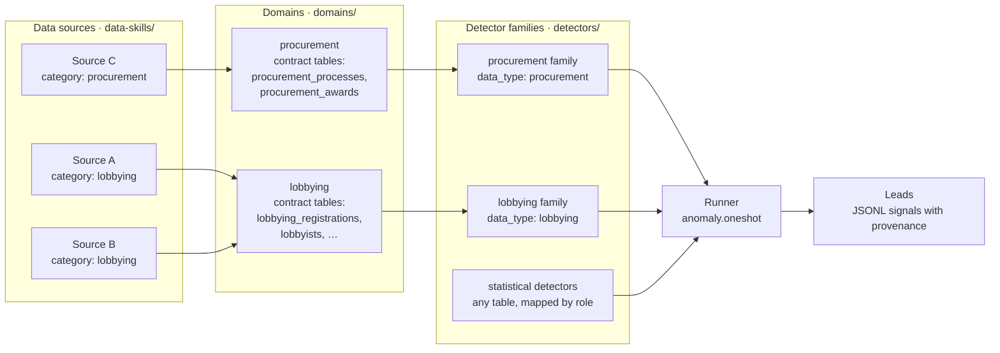

<div align="center">

# Anomaly

### Data sources and anomaly detectors for investigating agents

**Anomaly tells an investigating agent which data sources could help, how to get each one, and which detectors fit that type of data. It then runs those detectors deterministically on the tables the agent fetched. It has 41 data sources across 16 domains and 45 released detectors.**

[How it works](#how-it-works) | [Domains](#domains) | [Using it](#using-it-from-an-agent) | [Adding to it](#adding-sources-and-detectors) | [Website](https://anomaly.buriedsignals.com/)

[](#domains)[](#domains)[](#detectors)

Built by [**Buried Signals**](https://buriedsignals.com/) • [tom@buriedsignals.com](mailto:tom@buriedsignals.com)

</div>

---

Anomaly is context plus one runner. The agent reads the catalogue to learn what
data exists for its investigation and how to use it, fetches the data itself,
and hands the tables to the runner. The runner is SQL in a sealed DuckDB, so
the same tables always give the same result and no model does the arithmetic.

Every detector output is a lead. A detector flags an observation and never
establishes identity, intent, causation or wrongdoing.

## How it works

Sources and detectors never point at each other. Both point at a **domain**,
which is a type of data such as lobbying, procurement or company registries.
That is what lets hundreds of sources and many detector families grow
independently.



| Piece | Where | What it declares |
|---|---|---|
| **Data source** | `data-skills/<region>/<name>/` | `meta.yaml` with its domain (`category`), access, cost, licence and the contract tables it can fill (`provides`); `SKILL.md` on how to get and use the data; an optional `adapter.py` fetch script. |
| **Domain** | `domains/<domain>.yaml` | The tables that domain's detectors read and the meaning of each column. Only domains with multi-table detectors need one. |
| **Detector** | `detectors/<family>/<name>/` | The domain it reads (`data_type`), the tables or roles it needs, parameters, assumptions and known false positives, plus one read-only SQL query and fixtures. |

## How a detector gets its table

**Statistical detectors run on any table.** They ask for roles, and the caller maps
those roles onto columns. A z-score outlier test works the same on donations,
contract awards or a leaked spreadsheet.

| Detector | Roles it needs |
|---|---|
| `numeric.zscore_outliers` | `id`, `amount` |
| `numeric.level_shift` | `id`, `observed_at`, `amount` |
| `table.duplicate_rows` | `id` |
| `temporal.coverage_gaps` | `id`, `observed_at` |
| `categorical.rare_levels` | `group` |
| `table.missingness_clusters` | `group`, `amount` |

**Domain detectors read the domain's contract tables.** A pattern like a
lobbyist who used to work for the committee their client lobbies only shows
up across several tables. The domain contract fixes those tables and their
columns once, so any source that can fill them works with every detector in
the family. A source whose columns are named differently passes a column map
instead of being rewritten. Tests check that every detector query runs against
nothing but its contract's columns.

## Domains

| Domain | Sources | Detectors |
|---|---|---|
| campaign_finance | OpenFEC · UK Electoral Commission | 3, with a contract of 2 tables |
| companies | Zefix · Pappers · Companies House · GLEIF · OpenCorporates · Brønnøysund | 6, with a contract of 3 tables |
| court | ICC cases · CourtListener (5 skills) | 5, with a contract of 4 tables |
| entities | OCCRP Aleph · Wikidata | — |
| environment | EPA Envirofacts | — |
| filings | SEC EDGAR | — |
| geography | Wikimapia | — |
| legislation | Congress Corral · Congress.gov | — |
| lobbying | EU Transparency Register · Canada Registry of Lobbyists · Lobbying Disclosure Act filings · FARA · congress-legislators · Congress Press · LobbyData | 15, with a contract of 10 tables |
| news | GDELT | — |
| parliamentary | OpenParlData.ch · European Parliament · Party Facts | 5, with a contract of 5 tables |
| procurement | TED · Find a Tender · USAspending | 5, with a contract of 2 tables |
| regulations | Federal Register | — |
| sanctions | OpenSanctions | — |
| social | Bluesky · ThinkPol | — |
| statistics | Eurostat · DataHub | — |

Statistical detectors serve every domain. Run `python -m anomaly.context` for the live
version of this table with access, cost and licence per source.

A source is **queryable** when it ships an adapter, or **catalogued** when it
ships only `meta.yaml` and `SKILL.md`. Catalogued sources still tell the agent
that the data exists and how a person can get it, which matters for paid,
login-only or reuse-restricted data.

Six domains have their own detectors.

- **Lobbying** works across national registers. Its core tables
  (registrations, lobbyists, contacts with officials) hold what most registers
  publish, money is a low–high range because the EU, France and Germany only
  publish ranges, and a column a register doesn't publish is optional. Nine
  detectors run on any register; six need US-only tables such as FARA or
  political contributions. Each source's `SKILL.md` maps its own fields to
  the contract columns.
- **Procurement** has five detectors based on the Open Contracting
  Partnership's red flags (single bid, supplier share, non-open procedures,
  short submission periods, value growth). USAspending and Find a Tender fill
  its tables.
- **Campaign finance** has three detectors for donor clusters at the limit,
  gifts split under a reporting threshold, and new recipients funded by one
  donor. OpenFEC and the UK Electoral Commission fill its tables.
- **Companies** has six detectors from shell-company research by Global
  Witness, Open Ownership and the Tax Justice Network: many companies at one
  address, one person across many companies, dissolution within a year,
  control from a secrecy jurisdiction, circular ownership and frequent name
  changes. Companies House, GLEIF and Brønnøysund fill its tables.
- **Parliamentary** has five detectors for voting against one's own group, a
  sudden rise in it, absence well above the chamber's norm, many paid side
  mandates and group switches within a term. The European Parliament and
  OpenParlData.ch fill its tables.
- **Court** has five detectors for a judge holding stock in a party, gifts or
  paid trips from a litigant or their counsel, cases concentrated on one
  judge, a party repeatedly before the same judge, and civil cases pending
  more than three years. CourtListener fills its tables with an API token.

Known gaps: lda.gov and the Canada registry block scripted downloads from the
network used for testing, so both adapters were checked on real pages fetched
another way or on files from the official data dictionaries. CourtListener now
requires a token for every endpoint, and Companies House needs a key, so their
new operations are tested offline only. Matching people across tables (judges
and parties, officers across companies) uses names and can merge or split
people.

## Using it from an agent

```bash
# 1. What could help? Domains, sources (access, cost, licence) and detectors.
python -m anomaly.context --domain lobbying

# 2. How do I get this source? Its metadata plus the full SKILL.md.
python -m anomaly.context --source global/partyfacts/parties

# 3. Run detectors on tables the agent fetched.
python -m anomaly.oneshot --table donations.csv --request request.json --approved
python -m anomaly.oneshot --tables lobbying_registrations=registrations.csv \
  --tables lobbying_contacts=contacts.csv --request request.json --approved
```

A request names the detector by catalogue id and version, maps roles with
`fields` or contract columns with `columns`, and may tighten parameters within
their published bounds. The runner refuses anything outside the catalogue,
loads only the mapped or contract columns, seals DuckDB from external access
before the query runs, and returns at most ten detectors' signals per call.
[`docs/catalogue.md`](docs/catalogue.md) has the full request and catalogue
schema.

**Spotlight** pins `detectors/catalogue.json` by its `catalogue_hash`. Its
integration with this version is in review: an opted-in investigation reads
`anomaly.context` during Methodology to judge which domains and sources are
worth it, the investigator fetches the tables and calls the runner during the
Investigation phase, and the signals reach the Investigation gate as leads to
accept or dismiss.

## Detectors

The 45 released detectors are listed in `detectors/catalogue.json` with their
id, version, implementation hash, `data_type` and bounds. Another 12 packages
are drafts with placeholder SQL; they are left out of the catalogue and never
offered. Detector SQL runs read-only, and DDL, DML, `ATTACH`, `COPY` and
external readers are rejected at validation.

## Adding sources and detectors

- **A source:** copy an existing `data-skills/` folder, set `category` to its
  domain, and fill `provides` if it can fill contract tables. Nothing else
  changes.
- **A detector for an existing domain:** copy
  [`detectors/_template/`](detectors/_template/), set `data_type`, read only
  the domain's contract tables, and regenerate the catalogue with
  `python -m anomaly.catalogue --write`.
- **A new domain with multi-table detectors:** add `domains/<domain>.yaml`
  with its tables and columns, then its detector family. The contract test
  fails until every query runs on the contract's columns alone.

## Standalone case workflow

Anomaly also runs a full case on its own: register data, profile it, approve a
detector plan, run detectors, replay every calculation, have an independent
reviewer challenge each claim, and accept findings, with a portable case folder
and evidence viewer. Spotlight does not use this path. See
[`skills/anomaly/SKILL.md`](skills/anomaly/SKILL.md).

## Install

Anomaly needs Python 3.11+ and [uv](https://docs.astral.sh/uv/).

```bash
git clone https://github.com/buriedsignals/Anomaly.git
cd Anomaly
uv sync --extra test
uv run pytest tests/
```

Try the runner on the bundled example, which flags one donation:

```bash
uv run python -m anomaly.oneshot --table examples/donations.csv \
  --request examples/zscore_request.json --approved
```

## Documentation

| Doc | For |
|---|---|
| [`docs/catalogue.md`](docs/catalogue.md) | Catalogue schema and runner requests |
| [`domains/lobbying.yaml`](domains/lobbying.yaml) | The lobbying contract, as an example domain |
| [`skills/anomaly/SKILL.md`](skills/anomaly/SKILL.md) | Standalone case workflow, gates and redaction |
| [`agents/anomaly-data-reviewer.md`](agents/anomaly-data-reviewer.md) | Independent reviewer for the case workflow |
| [`AGENTS.md`](AGENTS.md) | Repository workflow and product constraints |

## Acknowledgements

Anomaly stands on open work — open-source projects, open data platforms, and
open methods. A sincere thank-you to every project below. *(Listing does not
imply affiliation or endorsement.)*

| Category | Projects we're grateful to |
|----------|----------------------------|
| **Computation** | [DuckDB](https://duckdb.org/) (MIT — the read-only investigation engine) · [Apache Arrow / PyArrow](https://arrow.apache.org/) (Apache-2.0) |
| **Public data platforms** | [USAspending](https://www.usaspending.gov/) · [SEC EDGAR](https://www.sec.gov/edgar) · [OpenFEC](https://api.open.fec.gov/) · [CourtListener / Free Law Project](https://www.courtlistener.com/) · [Federal Register](https://www.federalregister.gov/) · [US EPA Envirofacts](https://www.epa.gov/envirofacts) · [Congress.gov](https://www.congress.gov/) · [LDA.gov](https://lda.gov/) · [FARA](https://efile.fara.gov/) · [unitedstates/congress-legislators](https://github.com/unitedstates/congress-legislators) · [Congress Press](https://github.com/dwillis/congress-press) |
| **Companies & entities** | [Companies House](https://find-and-update.company-information.service.gov.uk/) · [OpenCorporates](https://opencorporates.com/) · [GLEIF](https://www.gleif.org/) · [OCCRP Aleph](https://aleph.occrp.org/) · [OpenSanctions](https://www.opensanctions.org/) · [Wikidata](https://www.wikidata.org/) · CH Zefix · Pappers · Brreg |
| **Procurement & parliament** | [EU TED](https://ted.europa.eu/) · [Eurostat](https://ec.europa.eu/eurostat) · [European Parliament open data](https://data.europarl.europa.eu/) · OpenParldata |
| **Methodology** | [Data2Story](https://github.com/QinghongLin/data2story-skill) by Qinghong Lin et al. (context-before-interpretation, stable evidence IDs, artifact-based handoffs) · [Spotlight](https://github.com/buriedsignals/spotlight) (gates, durable state, and bounded-retry discipline Anomaly inherited) |

> Built something here we should credit, or want a listing changed or removed?
> Open an issue or PR — we'll fix it fast.

## License

[MIT](LICENSE).
